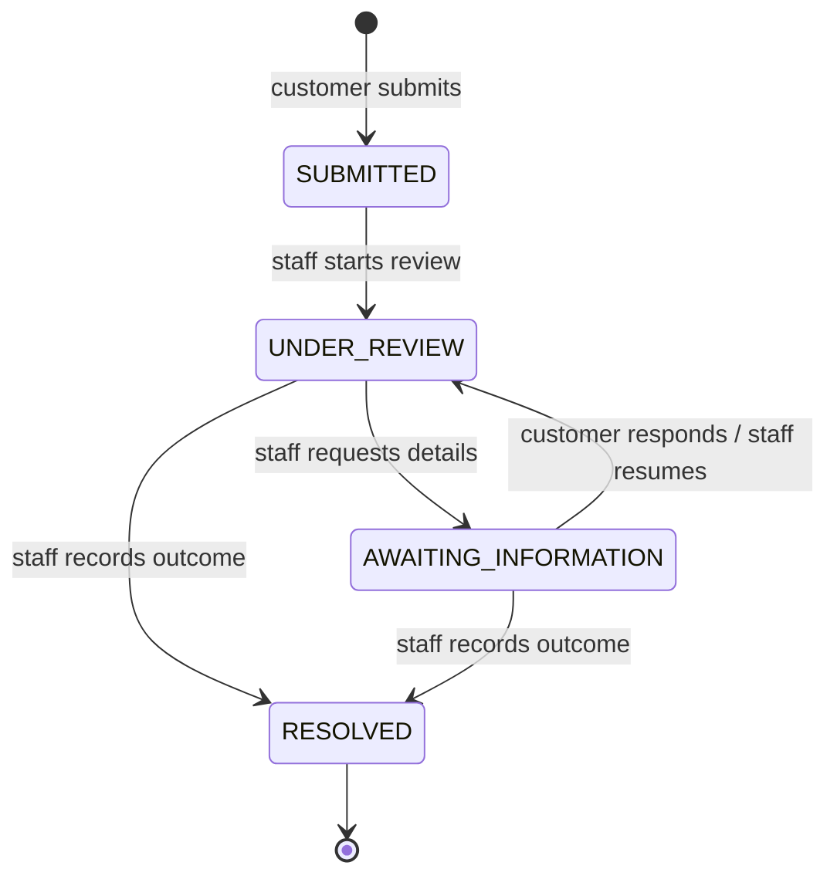

# Ntsumele Bank — transactions and disputes

An Angular customer workspace and Java Spring Boot API for viewing authorized account transactions, submitting dispute cases, and following the complete case history. A separate staff workspace supports review, information requests, and resolution. The backend and Angular client use a feature-based structure. Each banking feature owns its API, action-focused business logic, persistence, and view/request types, grouped into feature-prefixed class-type subpackages.

**A transaction is a financial record. A dispute is a separate case referencing that record. No dispute operation changes the original amount, account, currency, or ledger reference.**

The repository includes production-oriented authorization, validation, transactional concurrency controls, database migrations, CSRF protection, audit events, integration tests, and a non-root Docker image. The database is **PostgreSQL 17**, with durable storage in the supplied Docker Compose setup. This is a runnable reference implementation with fictional data, not an approved banking deployment. Approved retention/backup controls, the real bank identity and ledger integrations, and institution-specific compliance approval are required before using real customer information. See [operations](docs/OPERATIONS.md) and [compliance assessment](docs/COMPLIANCE.md).

The interface uses a Capitec-referenced blue, red, white and light-grey palette. See the [theme reference and contrast checks](docs/THEME.md) for the colour tokens and their use.

## Run with Docker

Install Docker with Linux containers. From this directory, copy the environment template:

```powershell
Copy-Item .env.example .env
```

On macOS/Linux use `cp .env.example .env`. Edit `.env` and replace **both** password placeholders with different randomly generated passwords. Keep this file private; it is ignored by Git and Docker builds.

```sh
docker compose up --build
```

Open <http://localhost:8080>. Compose starts PostgreSQL, waits for its health check, then starts the bank. The database port is internal to the Compose network. This loopback-only demo explicitly uses plaintext JDBC; the default driver setting and production secure profile require verified TLS. PostgreSQL data is stored in the `postgres-data` named volume; cases, history, audit events and idempotency records survive application and container restarts. `docker compose down` retains this volume. **`docker compose down -v` deletes the database.** Sessions are held in the Java process, so customers must sign in again after an application restart.

On first database initialization, `docker/postgres/01-application-role.sh` creates a separate, non-superuser application role that owns the schema used by Flyway. The bootstrap administrator credentials never enter the bank container. Password variables initialize a new volume only; changing `.env` does not change existing database role passwords. See [operations](docs/OPERATIONS.md) for rotation and recovery.

The multi-stage Dockerfile tests and builds Angular, runs the backend unit/architecture checks, packages Spring Boot, then runs the combined application as UID 10001 using Java 21. Building the image does not require a database server. PostgreSQL integration tests run separately in CI and through the documented integration profile. Angular and the API share an origin; Compose binds the application to the local machine, drops capabilities, and uses a read-only application container filesystem.

To build only the application image, run `docker build -t ntsumele-bank .`. Running that image requires a reachable PostgreSQL database plus `DB_URL`, `DB_USERNAME` and `DB_PASSWORD`; the Compose setup supplies these together.

The first build downloads npm and Maven dependencies and can take several minutes. BuildKit caches Maven's repository across builds. For expanded logs, run `docker compose --progress plain build`, then `docker compose up`. Keep the build cache when troubleshooting slow downloads.

## Existing H2 data

This release uses a new PostgreSQL database; it cannot open an H2 database file. The former in-memory database has no data after its process stops. If you used the old optional H2 file profile or still have a running instance with data to keep, preserve/export it before replacing that instance. An H2-to-PostgreSQL data importer is not bundled. Review and reconcile a controlled transfer of account access, transactions, cases, history, audit and idempotency records before any live cutover. See [the migration procedure](docs/OPERATIONS.md#moving-from-the-previous-h2-delivery).

## Demo identities

The default `demo` profile seeds these credentials using BCrypt hashes. Never expose this profile to real customers.

| Username | Password | Access |
| --- | --- | --- |
| `amy` | `Ntsumele!2026` | Two fictional customer accounts, transactions, and existing cases |
| `ben` | `Ntsumele!2026` | A different account, used to verify isolation |
| `reviewer` | `Review!2026` | Staff case queue and permitted lifecycle transitions |

Sign in as Amy, select an account, search or filter transactions, and choose **Dispute** on an eligible debit. View **Dispute history** to inspect previous and active cases and their timelines. Sign out and sign in as the reviewer to advance a case or request information. The customer can respond to an information request; resolved cases remain visible. Choose **Finished** in case details to close the popup and reload accounts, transaction states and dispute summaries while keeping your current view, account and filters. This viewing action does not resolve or update the case.

Account activity now shows **Payment status** separately from **Dispute status**: **Not disputed**, **Disputed**, or **Dispute resolved**. Each status has its own filter. Active cases link to **View dispute**; resolved transactions keep **View history**, plus **Dispute again** when eligible. Resolving a case preserves its history and never changes the original payment status or posts a refund. See [the status rules](docs/TRANSACTION-STATUS.md).

## Build and run locally

Requirements: **JDK 21**, **Node.js 24**, npm, and **PostgreSQL 17**. The checked-in Maven Wrapper downloads Maven 3.9.11 on first use; set `JAVA_HOME` to the JDK directory. Internet access is needed for the first dependency installation.

For a host-run backend, publish PostgreSQL only on local loopback with the optional override, after preparing `.env` above:

```sh
docker compose -f compose.yaml -f compose.local.yaml up -d --wait database
```

This extra file is optional for the all-container setup. If port 5432 is already occupied, use your own PostgreSQL instance or change the override and JDBC URLs consistently.

Create a separate disposable test database **once** (do not point integration tests at your application database):

```sh
docker compose exec database sh -c 'createdb -U "$POSTGRES_USER" -O "$APP_DB_USERNAME" ntsumele_test'
```

Set the connection variables in your terminal. The application password below must match `DB_PASSWORD` in `.env`; plain Java/Maven do not automatically read Compose's `.env` file.

PowerShell:

```powershell
$env:DB_URL = 'jdbc:postgresql://localhost:5432/ntsumele?sslmode=disable'
$env:DB_USERNAME = 'ntsumele'
$env:DB_PASSWORD = '<application password from .env>'
$env:TEST_DATABASE_URL = 'jdbc:postgresql://localhost:5432/ntsumele_test?sslmode=disable'
$env:TEST_DATABASE_USERNAME = $env:DB_USERNAME
$env:TEST_DATABASE_PASSWORD = $env:DB_PASSWORD
./scripts/build.ps1
java -jar backend/target/ntsumele-bank-1.0.0.jar
```

macOS/Linux:

```sh
export DB_URL='jdbc:postgresql://localhost:5432/ntsumele?sslmode=disable'
export DB_USERNAME='ntsumele'
export DB_PASSWORD='<application password from .env>'
export TEST_DATABASE_URL='jdbc:postgresql://localhost:5432/ntsumele_test?sslmode=disable'
export TEST_DATABASE_USERNAME="$DB_USERNAME"
export TEST_DATABASE_PASSWORD="$DB_PASSWORD"
sh scripts/build.sh
java -jar backend/target/ntsumele-bank-1.0.0.jar
```

Adjust database/user names if you changed the template. The build scripts require the three test connection variables, run frontend tests/build, and run the complete PostgreSQL integration profile before packaging. Visit <http://localhost:8080>.

For independent development with the application connection variables set, start the API with `sh ./mvnw -f backend/pom.xml spring-boot:run` (Windows: `./mvnw.cmd -f backend/pom.xml spring-boot:run`). In another terminal run `cd frontend`, `npm ci`, then `npm start`. Visit <http://localhost:4200>; the Angular dev proxy forwards `/api` to port 8080. A backend build without an Angular distribution provides the API; run the client build first for a combined JAR.

## Test

With the dedicated test database and `TEST_DATABASE_*` variables configured as above:

```sh
sh ./mvnw -B -ntp -f backend/pom.xml -Ppostgres-integration verify
cd frontend
npm ci
npm test
npm run build
```

On Windows use `./mvnw.cmd` instead of `sh ./mvnw`. The integration suite refuses URLs that do not target a PostgreSQL database whose name ends in `_test`. **It deletes and replaces test records**, so use a disposable database with its own credentials and no other consumers. Missing settings or an unavailable database fail the integration build.

`BankingPostgresIT` uses the real PostgreSQL driver, Flyway schema, Spring Security filter chain and database transactions. It covers authentication/CSRF, roles and cross-account access, immutable financial inputs, eligibility/staleness, idempotent replay/conflicts, concurrent duplicates, uniqueness, versions, lifecycle/history, committed data visible through an independent connection, native statement timeouts, and lock-timeout rollback followed by a successful same-key retry. Architecture checks guard feature ownership, dependency boundaries and repository-only SQL/JDBC. CI supplies PostgreSQL as a service and runs this same profile before building the Docker image.

`mvn package` or `mvn verify` without the profile runs unit/architecture checks only; it does **not** certify PostgreSQL behavior. Reports are in `backend/target/surefire-reports` (unit/architecture) and `backend/target/failsafe-reports` (integration). Frontend results print in the terminal.

## Structure and design

```text
frontend/           Angular standalone application and tests
backend/            Spring Boot API, domain service, security, Flyway, PostgreSQL
docs/API.md         HTTP contract and error semantics
docs/ARCHITECTURE.md Feature ownership, naming conventions, and source trees
docs/OPERATIONS.md  Ledger integration, deployment, backups, recovery
docs/COMPLIANCE.md  South African requirements and institution approvals
scripts/            Build-and-test helpers
Dockerfile          Node build → Maven package/unit checks → Java runtime
compose.yaml        Application + persistent PostgreSQL; internal database network
compose.local.yaml  Optional loopback database port for host development/tests
.env.example        Database credentials template; copy privately to .env
```

The Java entry point is `za.co.ntsumele.bank.NtsumeleBankApplication`. Feature roots contain descriptive camelCase subpackages that repeat the feature name and identify the class role:

```text
za/co/ntsumele/bank/
├── NtsumeleBankApplication.java
├── identity/      identityController/, identityService/, identityRepository/, ...
├── account/       accountController/, accountService/, accountRepository/, ...
├── transaction/   transactionController/, transactionService/, transactionPolicy/, ...
├── dispute/
│   ├── disputeController/ DisputesController, DisputeReviewsController
│   ├── disputeService/    DisputeInquiryService, DisputeSubmissionService, ...
│   ├── disputeRepository/ DisputeCaseRepository, DisputeHistoryRepository, ...
│   ├── disputeModel/      DisputeCase, DisputeStatus, DisputeReason, ...
│   ├── disputeDto/        DisputeSubmissionRequest, DisputeCaseResponse, ...
│   └── disputeMapper/     DisputeResponseMapper
├── audit/         auditService/, auditRepository/, auditModel/
├── failure/       failureException/
├── http/          httpHandler/, httpWriter/, httpFilter/, httpDto/
└── demo/          demoInitializer/, demoRepository/
```

The dispute feature separates customer case inquiry, case submission, staff review, and requested-information responses into focused use cases. Models, repositories, request/response records, and mappers stay inside their owning feature under the corresponding type package. For example, `dispute.disputeService` owns case use cases, while `dispute.disputeRepository` owns their SQL. Repositories consistently use the `Repository` suffix; action inputs use names such as `DisputeSubmissionRequest` and `DisputeStatusUpdateRequest`. The focused `http` and `failure` boundaries own transport and banking-failure contracts; they are not general-purpose shared code folders.

The Angular application uses standalone components and feature-scoped clients under `identity/`, `account/`, `transaction/`, and `dispute/`. Its `workspace/` composes those features, `http/` handles session-safe transport, and `icon/` owns the visual icon primitive. Models and request types belong to their respective features.

The existing physical build units retain their kebab-case names: Maven artifact `ntsumele-bank` and npm package `ntsumele-bank-frontend`. These are build/deployment boundaries; the domain features are logical boundaries inside the application. The detailed [architecture and naming guide](docs/ARCHITECTURE.md) explains the source trees, feature dependencies, and naming conventions. HTTP endpoints, JSON fields and logical database identifiers retain their established contracts. Flyway now initializes a PostgreSQL schema; existing H2 database files are not reused.

`ledger_transaction` holds read-only ledger snapshots. `account_access` grants customers access to accounts. `dispute_case` references a ledger transaction; `dispute_history` retains each transition and customer response; `audit_event` records actors, times, and significant changes. Monetary values use SQL `DECIMAL(19,2)` and Java `BigDecimal`. Database access uses bound parameters.

Every customer query and mutation checks account membership on the server. Unauthorized object IDs return 404. Customers cannot access staff endpoints. The create-dispute DTO accepts only `transactionId`, `reason`, and `description`; additional properties such as `amount` or `owner` are rejected. The server retrieves all financial fields from its ledger projection.

Within a database transaction, customer and transaction row locks serialize creation. A unique nullable active-transaction key is the final guard against multiple open cases. A principal-scoped `Idempotency-Key` is tied to a hash of the submitted payload and stored atomically with the case and audit history. Repeating the same request returns the existing case; reusing a key with different content returns 409. A closed case releases the active key, allowing a new case while preserving previous records. This is an explicit local business policy; a bank must replace it where scheme rules require another policy.



Staff transitions and customer information responses require the current case `version`; a stale write receives 409. `RESOLVED` is terminal. Resolution records an outcome; it does not create a refund or post an accounting entry. All state changes and their history commit together.

## Configuration

| Setting | Default / purpose |
| --- | --- |
| `SPRING_PROFILES_ACTIVE` | Default `demo`; `secure` enforces trusted forwarding, HTTPS and verified database TLS, and needs provisioned identities/ledger data |
| `DB_URL` | Default includes `sslmode=verify-full`; local demo explicitly opts out. Production URL must include `sslmode=verify-full` |
| `DB_SSL_ROOT_CERT` | Required readable PostgreSQL CA file in the secure profile; production manifest mounts it read-only |
| `PUBLIC_ORIGIN`, `TRUSTED_PROXY_REGEX` | Required production HTTPS origin and exact trusted ingress socket-address pattern |
| `IDEMPOTENCY_RETENTION` | Default `90d` after both replay-record creation and case resolution/update; active cases are retained |
| `DB_USERNAME` | `ntsumele`; separate application role, not the bootstrap administrator |
| `DB_PASSWORD` | Required application database password; no embedded/blank fallback |
| `POSTGRES_DB`, `POSTGRES_USER`, `POSTGRES_PASSWORD` | Compose bootstrap database, administrator role and required password; used only by PostgreSQL initialization |
| `TEST_DATABASE_URL`, `TEST_DATABASE_USERNAME`, `TEST_DATABASE_PASSWORD` | Required by the integration profile; a disposable PostgreSQL database ending in `_test` |
| `SERVER_PORT` | `8080` |
| `APP_LEDGER_MAX_AGE` | `24h` local freshness policy; rejects disputes using stale snapshots |

The former `file` profile is removed. Storage belongs to PostgreSQL, not the application container. Flyway validates schema history and applies versioned migrations; database cleaning is disabled. The demo role can migrate its own schema but cannot create roles or databases and is not a superuser. Use separate reviewed migration/runtime roles, encrypted transport/storage, a secret manager and institution-approved PostgreSQL hosting before live operation. The Compose deployment is a single local database instance; its volume is not a backup or high-availability arrangement.

There is no real ledger transport, refund integration, payment-scheme deadline engine, production customer onboarding, or OIDC/MFA provider in this reference. The default seeded snapshots are refreshed only at initial seeding, not through a banking API. Their freshness gate may make them ineligible after 24 hours. The operations guide defines the required trusted provider boundary, pending and reversal treatment, reconciliation, idempotent ingestion, timeouts, retries, and recovery. The `secure` profile is not a complete production profile: provisioning and all rollout gates still apply.

Session cookies are HttpOnly and SameSite Strict; writes, including login, require CSRF. Login rotates the session. Sessions expire after 15 minutes of inactivity. The UI gets a fresh CSRF token before mutations. No auth token is stored in local storage. The process sets security headers, a 16 KiB JSON mutation limit (including chunked bodies), bounded input/page sizes, graceful shutdown, and a local login limiter. The client applies 15-second request timeouts and suppresses stale account responses. Add approved enterprise authentication, TLS termination, gateway throttling, centralized monitoring, and protected audit retention before live operation.

Application lockfiles, Docker base/Compose images and GitHub Actions now use reviewed fixed versions, digests or full commit SHAs. Renovate, dependency/image/code scans, SBOM generation and protected signing/deployment workflows are included; activation and evidence are documented in [SUPPLY-CHAIN.md](docs/SUPPLY-CHAIN.md) and [RELEASE.md](docs/RELEASE.md). This repository makes no claim of POPIA or financial-regulator certification.


## Submission and operational hardening

Start with [SUBMISSION.md](docs/SUBMISSION.md) for the demonstration flow and verified results. Both dispute list endpoints now return paginated summaries (`content`, totals and page metadata), with size 1–100 and stable newest-first ordering. Full timelines load only when a case is opened. Dedicated `/api/disputes/summary` and `/api/staff/disputes/summary` endpoints keep dashboard totals accurate across pages. This changes the previous array response; the bundled Angular client is updated together with the backend. See [API.md](docs/API.md).

PostgreSQL migration V2 preserves existing cases/history/references and adds queue/cleanup indexes plus a non-cycling case-reference sequence. New references use `NB-<UTC year>-<12-or-more decimal digits>`. The hourly cleanup removes at most 500 eligible replay records per run by default, skips locked rows and records an aggregate audit event. It never deletes active-case keys, cases, timelines or existing audit events. Replay guarantees end once a closed-case record is legitimately purged; review the default 90-day policy against the institution's requirements.

The secure profile requires `PUBLIC_ORIGIN`, `TRUSTED_PROXY_REGEX`, `DB_SSL_ROOT_CERT`, and a verified-TLS JDBC URL. Plaintext GET/HEAD requests redirect to the configured HTTPS origin; plaintext mutations are rejected. HSTS is sent on secure responses, and the Nginx example also sets it at the TLS edge. Forwarded headers from other socket peers are ignored. See [OPERATIONS.md](docs/OPERATIONS.md) for trust-boundary configuration and the explicit local-demo exception.

Additional verification and inventory commands (from the project root):

```sh
./mvnw -B -ntp -f backend/pom.xml -Psbom package
./mvnw -B -ntp -f backend/pom.xml -Psecurity verify
python scripts/release/validate-policy.py
python -m unittest discover -s scripts/release/tests
```

On Windows use `./mvnw.cmd`. Dependency-Check needs online vulnerability data; set the `NVD_API_KEY` environment secret in CI. The `postgres-tls` profile additionally needs `TEST_DATABASE_TLS_URL` (localhost, `_test`, `sslmode=verify-full`), `TEST_DATABASE_SSL_ROOT_CERT` and `TEST_DATABASE_WRONG_SSL_ROOT_CERT` against a TLS-enabled disposable server. CI creates short-lived test certificates with `scripts/ci/enable-postgres-tls.sh`, then runs that profile. These test keys are never production credentials.

The checked-in workflows build, scan, generate inventories and provide opt-in GHCR publishing, OIDC signing/attestation and protected digest deployment. Repository administrators must enable Renovate, required checks/environments, registry permissions and the production runner/configuration. No registry publication or production deployment was performed locally.
